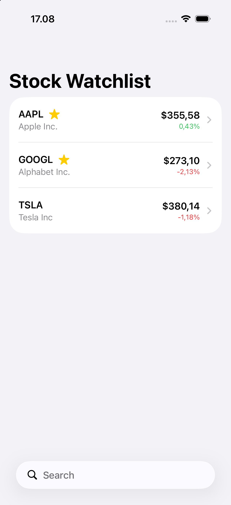
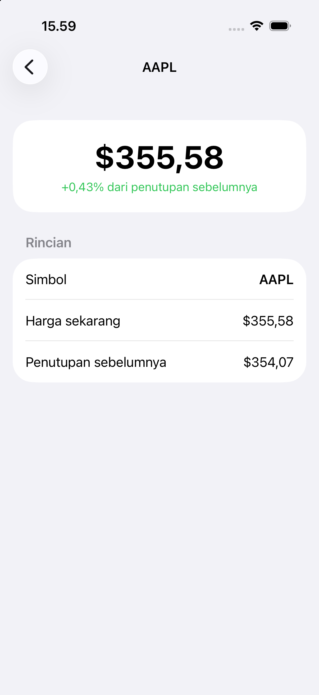

# StockApp

A SwiftUI iOS app that shows a stock watchlist with prices from the [Finnhub](https://finnhub.io) API. Built as a learning and portfolio project to practice Swift, SwiftUI, and the MVVM pattern.

## Screenshots

| Watchlist | Detail |
|---|---|
|  |  |

## Features

- Watchlist of stocks (currently AAPL, TSLA, and GOOGL) with the current price and the percent change since the previous close
- Green and red indicators for gains and losses
- Detail screen with the symbol, current price, and previous close
- Pull-to-refresh
- Search by stock symbol (case-insensitive)
- Favorite stocks: swipe a row to mark it with a star; favorites are saved on the device with `UserDefaults` and survive app restarts
- Loading and error states: a failed request (for example a timeout) shows a message instead of an endless spinner

## Tech

- Swift and SwiftUI
- MVVM
- async/await
- Finnhub REST API (quote and company profile endpoints)
- Codable models
- XCTest unit tests, with a mock API service injected into the view model

## Project structure

```
StockApp/                  App source
├── Models/        Stock model (computed percent change, formatting)
├── Networking/    StockAPIService, talks to the Finnhub API
├── ViewModels/    StockListViewModel, holds loading, error, and list state
├── Views/         StockListView, StockDetailView
└── Utilities/     Number formatting helpers

StockAppTests/             Unit tests (changePercent, search) using a mock API service
```

## Getting started

**Requirements**

- A recent version of Xcode with the iOS 26.5 SDK and simulator (the project's minimum deployment target is iOS 26.5)
- A free Finnhub API key from [finnhub.io](https://finnhub.io)

**Setup**

1. Clone the repository.
2. Copy `Secrets.example.xcconfig` to `StockApp/Secrets.xcconfig`.
3. Open `StockApp/Secrets.xcconfig` and replace the placeholder with your own Finnhub API key.
4. Open `StockApp.xcodeproj` in Xcode, pick an iPhone simulator, and press Run (Cmd + R).

`Secrets.xcconfig` is listed in `.gitignore`, so your key is never committed. Do not commit your real key.

## Known limitations and roadmap

- [x] Show company names (fetched from Finnhub's profile endpoint)
- [x] Keep a stable order of stocks after a refresh
- [x] Search by symbol
- [x] Save favorites on the device
- [x] Unit tests
- [ ] UI polish
